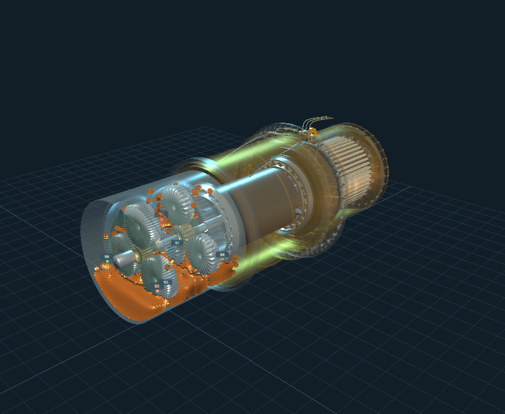

# Wheel Motor Fluid Lab

Integra el **modelo detallado del Wheel Motor Inspector** con los campos de aceite y las sondas de **V4 y V4.1**. Base GDY106; GDY108 se conserva como referencia documental, sin atribuirle cotas desconocidas.



## Abrir

Node.js 22+ y un navegador con WebGL2. Sin instalar dependencias:

```sh
npm start
```

Abrir **http://127.0.0.1:8848/**. En Windows también se puede ejecutar `INICIAR.ps1`. Incluye los resultados físicos completos: V4.1, 20 s por inventario, y V4, 2,4 s. Inventarios: 55, 95 y 125 L. De 2 a 12 sondas virtuales con posiciones y canales anidados.

## Qué se integró

- Motor del inspector: estator, bobinados, jaula, rotor, encoder, apoyos, carcasa y freno seco.
- Reductor de cálculo: solares, tres satélites por etapa, coronas fijas, portadores y acoplamientos; superficies idénticas a las fronteras guardadas por el solver.
- Aceite calculado con Salva/DFSPH: gravedad, viscosidad, contacto con paredes móviles; V4.1 añade tensión superficial, mojado y preparación gradual.
- Tiempo único por cuadro: partículas, piezas y señales utilizan el mismo instante físico y la fase guardada. Se evita interpolar partículas entre dos cuadros para no dibujarlas atravesando el metal.
- Sondas V4.1: ocupación con exclusión de metal, capacitancia coaxial, película auxiliar, respuesta de 80 ms y ruido reproducible.
- Exploración: conjunto integrado, reductor, inspector original completo; superficie suave o partículas; canal destacado, series temporales, CSV y captura PNG.
- Comparación V4/V4.1 con sus ventanas y modelos de sonda explícitos. No se presenta como ensayo A/B equivalente.

## Fidelidad y límites

La vista integrada **adapta el reductor visual a la geometría física existente**, en lugar de deformar aceite para hacerlo encajar en el CAD visual. El motor detallado se conserva fuera del compartimento calculado. La vista del inspector original conserva sus 41 conjuntos y oculta el aceite porque su geometría interna difiere de las fronteras SPH.

El recinto cilíndrico es fijo, Ø1,0 × 0,9 m, con cotas ilustrativas. La geometría de dientes es un polígono aproximado. Las rpm están prescritas, sin retroacción de torque ni electromagnetismo. La resolución aceptada es 32 mm entre partículas: representa redistribución macroscópica, sin resolver películas, burbujas, espuma, gas, desgaste o calentamiento. Los 60 °C, 300 rpm, densidad 900 kg/m³ y viscosidad 264,238 cSt son supuestos del estudio.

El folleto 930E-4SE publica GDY106, relación 32,62:1 y 95 L por caja reductora. No autentica las medidas o dentados del modelo. Los dientes ilustrativos dan 32,6087:1. La referencia GDY108 no usa una capacidad ni geometría específica no verificada.

**Estado: simulación exploratoria, sin validación experimental OEM.** Los controles de masa, contención y estabilidad no prueban precisión física. [Modelo, evidencia, hipótesis y próximos requisitos](docs/MODELO_Y_VALIDACION.md).

## Verificación

```sh
npm test
# Con el servidor encendido:
npm run test:api
```

El primer comando examina los seis casos completos: integridad, SHA del motor, coordenadas, fase, contención, ocupación, conservación y datos finitos. Incluye pruebas del cambio de base y la geometría de frontera. El segundo comprueba API, CSV, variantes, canales anidados y rechazo de parámetros fuera de alcance. [Informe ejecutado](reports/lab-verification.json).

## Calcular otro inventario

```sh
node run_case.mjs 85
```

Calcula un caso V4.1 nuevo con las condiciones fijas. Tarda varios minutos o más con CPU; el WASM incluido funciona sin Rust. Después puede abrirse por API con `/api/result?oil=85&sensors=6&backend=v41`. La interfaz ofrece los tres casos entregados para evitar iniciar cálculos largos por accidente. Para recompilar el motor: Rust, target `wasm32-unknown-unknown`, fuentes vendorizadas y [guía](docs/RECONSTRUIR.md). Cambiar geometría, rpm o aceite requiere recalcular; no se reutilizan resultados de otro motor.

## Procedencia

Fuentes preservadas, por commit:

| Proyecto | Commit |
|---|---|
| [Wheel Motor Inspector](https://github.com/joseroavargas409/wheel-motor-inspector) | `64bd32e69634f7be45afad43be4bbdbbb5725212` |
| [Oil Sensors V4](https://github.com/joseroavargas409/komatsu-oil-sensors-v4) | `675d92473857ad0b6bf6dfae5456993fa4cea17e` |
| [Oil Sensors V4.1](https://github.com/joseroavargas409/komatsu-oil-sensors-v4-1) | `8455afb44dc5156d7fd4e92eb62714397023547e` |

Los repositorios originales no se modificaron. Los resultados V4/V4.1 y el WASM son copias de esos commits; no se presentan como cálculos nuevos de la geometría completa del inspector. `dashboard/inspector/` conserva el ensamble; `dashboard/coupling.js` define la transformación rígida y las superficies comunes. `engine/` y `build/salva/` contienen el motor V4.1 y sus fuentes. `cfd/` conserva el banco de cizalla independiente de V4.1, que no valida el reductor completo.

Fuentes: [Komatsu 930E-4SE](https://www.komatsu.com/content/dam/komatsu/websites/oceania/documents/brochures/dump-trucks/930e-4se.pdf), [patente GE US7455616B2](https://patents.google.com/patent/US7455616B2/en), [benchmark de distribución de lubricante](https://arxiv.org/abs/2511.00496). Licencias y atribuciones: [THIRD_PARTY_NOTICES.md](THIRD_PARTY_NOTICES.md), [avisos del inspector](docs/AVISOS_INSPECTOR.md).
